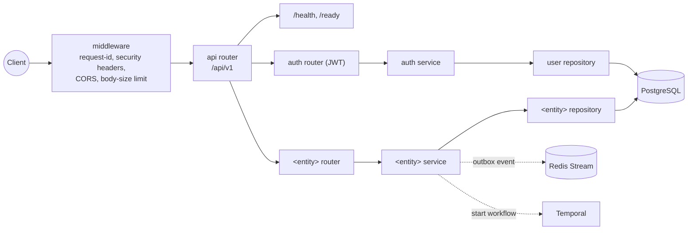

<p align="center">
  
</p>

<p align="center">
  <em>The solid, layered foundation you build your FastAPI service on.</em>
</p>

<p align="center">
  <a href="https://github.com/<your-org>/fastapi-bedrock/actions/workflows/test-template.yml">/fastapi-bedrock/actions/workflows/test-template.yml/badge.svg" alt="Test template"></a>
  
  
  
  
</p>

A modern [Cookiecutter](https://cookiecutter.readthedocs.io/) template for
production-ready **FastAPI** services organised with a **Domain-Driven Design**
(vertical-slice) layout — the solid foundation you build your service on.

Every generated project ships fully wired: async database access, a clean
repository/service layering, JWT authentication, tests, linting, typing,
Docker and CI — nothing to bolt on afterwards.

## Stack

| Concern             | Choice                                                             |
| ------------------- | ----------------------------------------------------------------- |
| Language            | Python 3.12 / 3.13 / 3.14 (defaults to 3.13)                      |
| Packaging / env     | [uv](https://docs.astral.sh/uv/) (PEP 621 + PEP 735)             |
| Web framework       | [FastAPI](https://fastapi.tiangolo.com/) (`fastapi[standard]`)    |
| Data / ORM          | [SQLModel](https://sqlmodel.tiangolo.com/) on SQLAlchemy 2.0 async — PostgreSQL / asyncpg |
| Migrations          | [Alembic](https://alembic.sqlalchemy.org/) (async)                |
| Validation / config | Pydantic v2 + `pydantic-settings`                                 |
| Auth                | OAuth2 password flow, JWT access + refresh, Argon2 (`pwdlib`)     |
| Lint + format       | [Ruff](https://docs.astral.sh/ruff/) (replaces black + isort)     |
| Type checking       | [mypy](https://mypy.readthedocs.io/) (strict, incl. tests)        |
| Tests               | pytest, httpx, polyfactory, testcontainers (real PostgreSQL)      |
| Logging             | [structlog](https://www.structlog.org/) (JSON) + request IDs      |
| Runtime extras      | Docker + compose, CI, rate limiting, Sentry, Temporal, Redis, OTel/Grafana |
| Dev experience      | devcontainer + VS Code presets, `make new-domain` scaffolder, `make seed`, keep-a-changelog + conventional commits |

## Architecture

The generated project follows a **repository → service → router** flow with
each domain as a self-contained vertical slice:



*Dashed arrows are optional slices (`use_redis`, `use_temporal`); the auth
slice ships with `use_auth=yes`.*

```text
src/<package>/
├── main.py                 # app factory, lifespan, middleware
├── core/                   # cross-cutting infrastructure
│   ├── config.py           # pydantic-settings
│   ├── database.py         # async engine + session dependency
│   ├── repository.py       # generic BaseRepository[Model]
│   ├── security.py         # password hashing + JWT (auth)
│   ├── logging.py          # structlog configuration
│   ├── middleware.py       # request-id middleware
│   └── exceptions.py       # domain errors + handlers
├── api/
│   ├── router.py           # aggregates every domain router under /api/v1
│   └── health.py           # /health and /ready probes
└── domains/
    ├── auth/               # User model, JWT login/refresh, current-user deps
    └── <entity>/           # models · schemas · repository · service · router
```

Business logic never touches the database directly: services depend on thin
repository classes, so a domain is trivial to unit-test and the persistence
layer stays swappable.

## Requirements

- [uv](https://docs.astral.sh/uv/) (recommended), or any Python 3.12+ with
  `cookiecutter` installed.

## Usage

```bash
# recommended: cruft, so generated projects can pull template updates later
uvx cruft create gh:<your-org>/fastapi-bedrock

# plain cookiecutter works too (no update tracking)
uvx cookiecutter gh:<your-org>/fastapi-bedrock
```

[cruft](https://cruft.github.io/cruft/) records the template revision in
`.cruft.json`, so a generated project can later run `uvx cruft update` to pull
in template improvements as a reviewable diff (the generated `CONTRIBUTING.md`
documents the workflow). You will be prompted for the variables below. When
generation finishes the hook initialises a fresh git repository and runs
`uv sync` (set the env var `SKIP_UV_SYNC=1` to opt out).

### Prompts

| Variable              | Description                               | Default               |
| --------------------- | ----------------------------------------- | --------------------- |
| `project_name`        | Human-readable name                       | `FastAPI DDD Service` |
| `project_slug`        | Repo/folder name (derived)                | `fastapi-ddd-service` |
| `package_name`        | Import package (derived)                  | `fastapi_ddd_service` |
| `project_description` | One-line description                      | —                     |
| `author_name`         | Your name                                 | —                     |
| `author_email`        | Your email                                | —                     |
| `version`             | Initial version                           | `0.1.0`               |
| `python_version`      | Target Python (`3.13` / `3.14` / `3.12`)  | `3.13`                |
| `first_entity`        | First domain entity (lowercase snake)     | `item`                |
| `use_auth`            | Include JWT authentication                | `yes`                 |
| `use_docker`          | Include Dockerfile + docker-compose       | `yes`                 |
| `use_github_actions`  | Include CI workflow                       | `yes`                 |
| `use_rate_limiting`   | Include slowapi rate limiting             | `yes`                 |
| `use_sentry`          | Include Sentry error tracking             | `no`                  |
| `use_temporal`        | Include Temporal.io durable workflows     | `no`                  |
| `use_redis`           | Redis cache + outbox/Streams events + lock | `no`                 |
| `use_observability`   | Include OpenTelemetry + Grafana/Loki/Tempo| `no`                  |
| `use_http_client`     | Resilient outbound HTTP client            | `no`                  |

## What you get after generation

```bash
cd <project_slug>
make setup                  # deps, .env (+ generated SECRET_KEY), database, migrations, git hooks
make run                    # uv run fastapi dev  ->  http://127.0.0.1:8000/docs
make test                   # pytest against a testcontainers PostgreSQL (needs Docker)
make lint                   # ruff check + format check
make typecheck              # mypy --strict (src + tests)
make new-domain name=order  # scaffold a full vertical slice + tests
make seed                   # fill the local database with demo data
```

The app runs on PostgreSQL (async, via asyncpg); `docker-compose.yml` provides a
local database and — when `use_temporal` is enabled — a Temporal server + worker.
Tables are auto-created in the local environment; staging and production use Alembic.

Each project also ships a `.devcontainer/` (VS Code Dev Containers / GitHub
Codespaces ready, compose-based when `use_docker=yes`), `.vscode/` presets
(Ruff format-on-save, pytest discovery), a keep-a-changelog `CHANGELOG.md` and
a `CONTRIBUTING.md` covering conventional commits and the `cruft update`
workflow.

## License

MIT — see [LICENSE](LICENSE).
