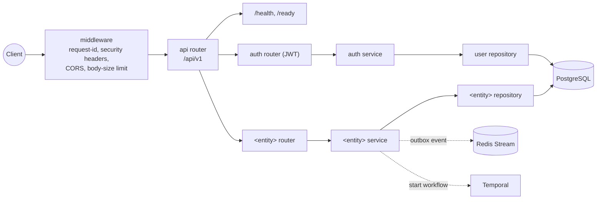

# Architecture

The generated project follows a **repository → service → router** flow with
each domain as a self-contained vertical slice.



*Dashed arrows are optional slices (`use_redis`, `use_temporal`); the auth
slice ships with `use_auth=yes`.*

## Directory layout

```text
src/<package>/
├── main.py                 # app factory, lifespan, middleware
├── core/                   # cross-cutting infrastructure
│   ├── config.py           # pydantic-settings, fail-fast production checks
│   ├── database.py         # async engine + session dependency
│   ├── repository.py       # generic BaseRepository[Model]
│   ├── security.py         # password hashing + JWT     (use_auth)
│   ├── logging.py          # structlog configuration
│   ├── middleware.py       # request-id middleware
│   └── exceptions.py       # domain errors + RFC 9457 handlers
├── api/
│   ├── router.py           # aggregates every domain router under /api/v1
│   └── health.py           # /health and /ready probes
├── domains/
│   ├── auth/               # User model, JWT login/refresh   (use_auth)
│   └── <entity>/           # models · schemas · repository · service · router
├── events/                 # outbox relay + Streams consumer (use_redis)
└── temporal/               # client, worker, workflows       (use_temporal)
```

## The layering rule

Business logic never touches the database directly:

- **Routers** own HTTP: request/response schemas, status codes, dependencies.
- **Services** own business logic and transactions; they raise typed domain
  errors (`NotFoundError`, `ConflictError`, …) that handlers render as
  RFC 9457 `application/problem+json`.
- **Repositories** own persistence: thin classes over a generic
  `BaseRepository[Model]`, so a domain is trivial to unit-test and the
  persistence layer stays swappable.

Every domain repeats the same five files (`models`, `schemas`, `repository`,
`service`, `router`), so any slice is navigable once you have read one.
`make new-domain name=order` scaffolds a complete new slice plus tests.

## Cross-cutting behaviour

- **Errors** — every error response is an RFC 9457 problem document with a
  stable `type` URN; validation failures add a field-level `errors` array.
- **Logging** — structlog emits one JSON `request_completed` event per
  request; every response carries an `X-Request-ID` header.
- **Config** — `pydantic-settings` with fail-fast validation: unsafe
  production configuration (default `SECRET_KEY`, `DEBUG=true`, wildcard
  `ALLOWED_HOSTS`) is rejected at boot rather than silently degraded.
- **Migrations** — Alembic owns the schema in staging/production; locally,
  tables auto-create at startup for convenience (`DB_AUTO_CREATE`, forced off
  outside `local`).
- **Events (optional)** — the transactional outbox removes the dual-write
  race: events are written in the same transaction as the domain change and
  relayed to a Redis Stream in a CloudEvents 1.0 envelope, consumed
  at-least-once with `XACK`/`XAUTOCLAIM`.
- **Workflows (optional)** — Temporal for durable, retried, long-running
  orchestration; the shipped recipe on background work explains when to use
  `BackgroundTasks` vs the outbox vs Temporal.

## Testing philosophy

Tests spin up a real PostgreSQL container (testcontainers) and drive the API
through an async httpx client — behaviour matches production instead of a
SQLite stand-in. `mypy --strict` covers `src` and `tests`, and Ruff enforces
lint + format. `make check` runs everything.
